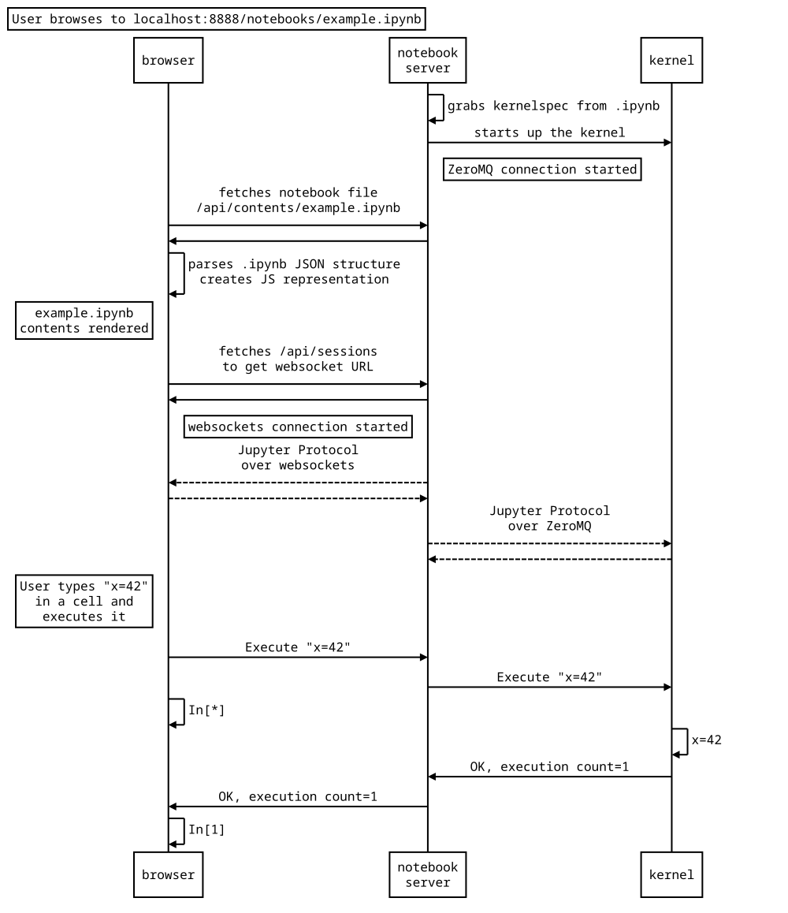

Main focus of this blog is the youtube video - [Jupyter: Kernels, Protocols, and the IPython Reference Implementation](https://www.youtube.com/watch?v=GExKsQ-OU78&t=189s).

<iframe width="560" height="315" src="https://www.youtube.com/embed/GExKsQ-OU78?si=qYZT4dV2_ETKnoMS"></iframe>

REPL (Read Evaluate Print Loop), was available for python and it is like a interactive shell. You type code and it gives output. Mainly REPL is works best for languages which are meant to be interpreted like python, julia.

So in REPL, you type something and press enter, it goes to python interpreter and it give some output which is displayed. If we want to convert this to a jupyter notebook we have to decouple this into components. Mainly three components, first is the python interpreter which is running the code and giving output, second a middleware which will communicate with the python interpreter, and third a frontend which will communicate with middleware. This middleware is called `notebook server` and python interpreter is called `kernel`.

`notebook server` and `kernel` communicates via `ZeroMQ` protocol. `notebook server` and browser in which you are running the frontend communicates via `websocket` protocol.

More details about how messaging specifications can be found here [https://jupyter-client.readthedocs.io/en/latest/messaging.html](https://jupyter-client.readthedocs.io/en/latest/messaging.html)