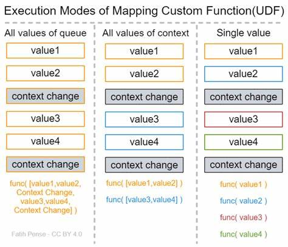

In SAP CPI when you use mappings to transform xml from one structure to another structure. While transforming you can perform operations on the elements, like splitting and concatenating and changing their format. Some of these functionality is provided itself by SAP CPI, but if you want some new functionality you can utilize a groovy function block there.

Here is link to Standard Functions provided in message mappings -[https://help.sap.com/doc/saphelp\_nw73ehp1/7.31.19/en-us/4b/f413a8eaca4c86e10000000a42189e/frameset.htm](https://help.sap.com/doc/saphelp_nw73ehp1/7.31.19/en-us/4b/f413a8eaca4c86e10000000a42189e/frameset.htm)

In case the functionality you want to implement is not present in Standard Functions you can use groovy scripts.

## Types of SAP CPI Message mapping groovy scripts

Here is a link to what kind of functionality can be achieved using groovy script and it's limitations in SAP CPI when compared to SAP PI/PO - [https://community.sap.com/t5/technology-blogs-by-members/cloud-integration-cpi-custom-functions-in-message-mapping-udf-and/ba-p/13500012](https://community.sap.com/t5/technology-blogs-by-members/cloud-integration-cpi-custom-functions-in-message-mapping-udf-and/ba-p/13500012)



As you can in the above diagram that SAP CPI does not support the mode where you can take all values and then process them, instead you can take values one by one or you can take all values in context and process them. Sometimes for processing all values you can use `removeContext()` and then process all values in context, but this cannot be used if care about how values are stored in context.

### Process single value at a time

So here is the basic structure of how script looks when you want to process values one by one in the context.

```java
import com.sap.it.api.mapping.*

def String exampleSingleValue(String field) {
	// Your code here

	return result;
}
```

If you want to process two fields then,

```java
import com.sap.it.api.mapping.*

def String exampleSingleValue(String field1, String field2) {
	// Your code here

	return result;
}
```

Similarly you can generalize for multiple fields.

### Process all values in context at a time

Basic structure of script to process all values in context at a time,

```java
import com.sap.it.api.mapping.*

def void exampleAllValuesInContext(
    String[] fieldArray, 
    Output output, 
    MappingContext context
){
	//Your code here

    // how to add values to output
	output.addValue(result1);
	output.addSuppress();
	output.addValue(result2);
}
```

In case of multiple fields,

```java
import com.sap.it.api.mapping.*

def void exampleAllValuesInContext(
    String[] field1Array, 
    String[] field2Array, 
    Output output, 
    MappingContext context
){
	//Your code here
}
```

Notice that we have `output.addSuppress()` method, this just adds `"SUPPRESS"` to output.

### `MappingContext` in scripts

You can add `MappingContext context` parameter to both types of scripts, we have omitted it in the first type as it is not necessary.

Using `MappingContext` you can get headers and set headers, using `context.getHeader(key)` and `context.setHeader(key, value)` .

Here is link to javadoc for `MappingContext` - [https://help.sap.com/doc/d47441d304c14a0ab9d3986c1b553a1e/Cloud/en-US/com/sap/it/api/mapping/MappingContext.html](https://help.sap.com/doc/d47441d304c14a0ab9d3986c1b553a1e/Cloud/en-US/com/sap/it/api/mapping/MappingContext.html)

## Confusions and misconceptions

* There is not "all values in queue" mode for SAP CPI
    
    * [https://community.sap.com/t5/technology-q-a/use-of-iscontextchange-in-groovy-script-cpi/qaq-p/11998731](https://community.sap.com/t5/technology-q-a/use-of-iscontextchange-in-groovy-script-cpi/qaq-p/11998731)
        
    * [https://community.sap.com/t5/technology-q-a/sap-cpi-udf-execution-type-all-values-of-queue/qaq-p/12176514](https://community.sap.com/t5/technology-q-a/sap-cpi-udf-execution-type-all-values-of-queue/qaq-p/12176514)
        

## Other links

* Implementing all Standard functions using groovy scripts - [https://community.sap.com/t5/technology-blogs-by-members/udfnodepool-functions-for-sap-cpi-with-groovy-scripting/ba-p/13505654](https://community.sap.com/t5/technology-blogs-by-members/udfnodepool-functions-for-sap-cpi-with-groovy-scripting/ba-p/13505654)
    
* Style guide for groovy scripting - [https://groovy-lang.org/style-guide.html](https://groovy-lang.org/style-guide.html)
